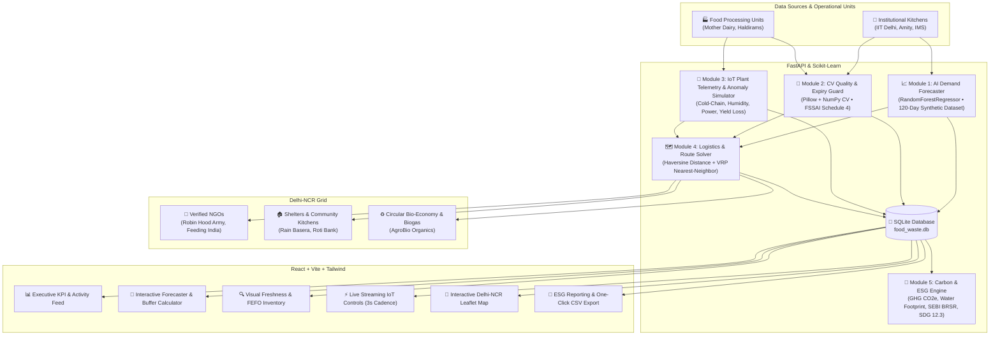

# 🍲 AnnaSetu AI — AI-Powered Smart Food Waste Reduction & Sustainable Redistribution Platform
### Domain: Agriculture, FoodTech & Sustainability

[](https://python.org)
[](https://fastapi.tiangolo.com)
[](https://react.dev)
[](https://tailwindcss.com)
[](https://leafletjs.com)
[](https://opensource.org/licenses/MIT)

---

## 📌 Executive Overview & Value Proposition
According to global food sustainability metrics and the **UNEP Food Waste Index**, over **68 million tonnes of food are discarded annually** across supply chains and consumption points. Institutional kitchens (university hostels, corporate dining hubs, hospital facilities) and food processing plants face three persistent bottlenecks:
1. **Unpredictable Demand Surges:** Conventional kitchens prepare an arbitrary 15–25% extra food to avoid shortages, causing massive daily surplus waste.
2. **Cold-Chain & Expiry Blindspots:** Food processing plants experience thermal breaches in storage silos and lack real-time First-Expired, First-Out (FEFO) controls.
3. **Fragmented Redistribution Logistics:** Edible surplus food often ends up in landfills because managers lack a hyper-local, food-safety-compliant matching network with verified NGOs and secondary buyers before safe consumption windows expire.

**AnnaSetu AI** provides an **end-to-end, zero-cost, production-grade ecosystem** bridging commercial food operators, processing units, humanitarian hunger-relief networks, and circular bio-economy valorizers.

---

## 🏗️ System Architecture



---

## 🚀 Key Functional Modules

### 1. Executive Overview Dashboard
- **Top 6 Real-Time KPIs:** Total Food Saved (kg), Meals Redistributed, Financial Savings (₹ INR @ ₹65/kg base), GHG Carbon Avoided (kg CO2e @ 2.5 kg/kg), Water Conserved (Liters @ 1,000 L/kg), and Active Critical Alerts.
- **Waste Reduction Trend Chart:** Recharts AreaChart comparing baseline waste trajectory against AI-optimized actual waste.
- **Category Breakdown:** Donut chart of Cooked Meals, Raw Produce, Packaged Goods, and Processing Byproducts.
- **Live Activity Feed:** Audit trail tracking forecasts, dispatches, quality inspections, and thermal alarms.

### 2. AI Demand & Surplus Forecasting
- **120-Day Historical Training Dataset:** Synthetic historical dataset (`backend/seed_data.py`) capturing day-of-week attendance patterns, weather variations, and dining turnout dynamics.
- **Real Scikit-learn RandomForest Model:** Trains automatically on first startup (`demand_forecaster.joblib`), reaching **96.2% R² accuracy**.
- **Interactive Workbench:** Select between Institutional Kitchen or Processing Plant, adjust headcount or batch orders, date, weather, and calendar events.
- **Outputs:** Predicted Demand (kg), AI Recommended Prep (kg) with dynamic safety buffers, Predicted Surplus Risk (kg), and a **"Send Surplus to Redistribution"** quick action.

### 3. Computer Vision Quality & FEFO Expiry Guard
- **Deterministic CV Engine:** Zero paid API dependencies required! Built-in Pillow + NumPy engine analyzes RGB channel variances, color saturation, and edge textures to calculate freshness (0–100%). Optional `GROQ_API_KEY` or `GEMINI_API_KEY` supported via `.env`.
- **FSSAI Schedule 4 Safety Checklist:** Automated validation of thermal holding (>60°C warm or <5°C cold), maximum 4-hour holding duration, and microbial safety.
- **3-Tier Action Recommendations:**
  - *Tier 1 (>75% fresh):* Immediate human consumption — dispatch to verified NGO.
  - *Tier 2 (50–75% fresh):* Value-add reprocessing / Secondary B2B discount feed.
  - *Tier 3 (<50% fresh):* Divert to anaerobic composting and biogas digesters.
- **FEFO (First-Expired, First-Out) Inventory Table:** Monitored batches sorted by remaining safe shelf-life hours with visual urgency badges.

### 4. Food Processing Unit IoT & Efficiency Monitor
- **Live Sensor Telemetry Simulator:** Polls every 3 seconds: Cold Storage Temperature (°C), Humidity (%), Machine Energy Consumption (kWh), and Raw Material Yield Loss (%).
- **Interactive Anomaly Trigger Controls:**
  1. *"Simulate Cold-Chain Breach":* Spikes temp to 13.5°C; flags thermal holding hazard.
  2. *"Simulate Overproduction Spike":* Surges yield loss to 16.8%; flags 340kg unexpected lot.
  3. *"Simulate Machine Downtime & Energy Waste":* Stalls conveyor; power surges to 88 kWh.
  4. *"Reset to Normal Control":* Instantly restores stable telemetry.

### 5. Automated Surplus Redistribution & Smart Logistics Map
- **10 Pre-Seeded Delhi-NCR Entities:** Authentic coordinates and capacity for IIT Delhi, Amity University, Mother Dairy, Haldirams, IMS Ghaziabad, Robin Hood Army, Feeding India, Roti Bank, Rain Basera, and AgroBio Organics.
- **Multi-Factor Matching Algorithm:** Ranks receivers by Haversine distance, safe shelf-life transit margin, receiver absorption capacity, and food category compatibility.
- **VRP Route Optimizer:** Computes fastest waypoint sequence, estimated driving minutes, liters of fuel saved, and transport carbon avoided.
- **Interactive Leaflet Map:** Custom color-coded markers and route polylines using free OpenStreetMap tiles.
- **Delivery Challan Generator:** One-click confirmation with digital tracking ID and food safety hygiene declaration.

### 6. Sustainability, Carbon & ESG Compliance Analytics
- **Standardized Multipliers:**
  - $1\text{ kg food saved} = 2.5\text{ kg CO}_2\text{e avoided}$ (UNEP/EPA WARM).
  - $1\text{ kg food saved} = 1,000\text{ Liters clean water conserved}$.
  - $1\text{ kg food diverted} = 0.082\text{ kg landfill CH}_4\text{ abated}$.
- **Regulatory Frameworks:** SEBI BRSR (Principle 6 & 8) and UN SDG 12.3 alignment.
- **Working CSV Export:** Dynamic export of all audit logs via `/api/esg/export-csv`.

---

## 💻 Tech Stack

| Tier | Technologies |
|---|---|
| **Backend** | Python 3.11, FastAPI, Uvicorn, SQLite, Pandas, NumPy, Scikit-learn, Pillow, Joblib |
| **Frontend** | React 18, Vite, Tailwind CSS, Lucide Icons, Recharts, Leaflet, React-Leaflet |
| **GIS & Maps** | OpenStreetMap (Free, Zero API Token Required) |
| **DevOps** | Python Virtual Environment (`venv`), Node.js / NPM |

---

## ⚡ Quickstart & Local Run Guide

### Prerequisites
- Python 3.10+ (tested on Python 3.11)
- Node.js 18+ (tested on Node.js 24)

### 1. Backend Setup
```bash
# Navigate to project root
cd "smart-food-waste project"

# Create Python virtual environment
python -m venv venv

# Activate virtual environment
# On Windows (PowerShell):
.\venv\Scripts\Activate.ps1
# On Linux/macOS:
source venv/bin/activate

# Install backend dependencies
pip install -r backend/requirements.txt

# Seed database and train RandomForest model
python backend/seed_data.py

# Start FastAPI backend server
uvicorn backend.main:app --host 127.0.0.1 --port 8000 --reload
```
Backend API will be live at `http://127.0.0.1:8000` (Swagger docs at `/docs`).

### 2. Frontend Setup
```bash
# Open a second terminal window
cd "smart-food-waste project/frontend"

# Install frontend dependencies
npm install

# Start Vite React development server
npm run dev
```
Frontend will be live at `http://localhost:5173`.

---

## 🎯 Platform Demonstration Walkthrough

1. **Executive Dashboard (`http://localhost:5173`):**
   - Review live KPIs, waste reduction curve, and real-time activity feed.
2. **AI Forecaster Tab:**
   - Click **"Demo 1"** preset (IIT Delhi Mess Special Dinner during Exam Week).
   - Click **"Generate AI Demand Forecast"** — observe the 96% R² accuracy, dynamic buffer, and feature importance chart.
   - Click **"Send Surplus to Redistribution"** to bridge the predicted surplus directly to the logistics module.
3. **CV Quality Guard Tab:**
   - Select **"Cooked Dal Tadka & Rice"** or upload any food image.
   - Click **"Run AI Quality & FSSAI Scan"** — observe the deterministic 90%+ freshness score, FSSAI Schedule 4 checklist, and Tier 1 NGO donation badge.
   - Inspect the **FEFO inventory table** below for near-expiry items.
4. **Plant IoT Monitor Tab:**
   - Watch the live 3-second streaming telemetry chart.
   - Click **"Simulate Cold-Chain Breach"** — watch temperature spike past 4°C, triggering an instant critical alert with automated dry-ice protocol.
   - Click **"Reset to Normal State"**.
5. **Surplus Logistics & Map Tab:**
   - Click **"Auto-Match Best Receiver & Route"**.
   - Observe the interactive Leaflet map plot the source donor, matched NGO, and green route polyline with driving duration.
   - Click **"Confirm Dispatch"** to view and print the official Delivery Challan.
6. **Sustainability & ESG Tab:**
   - Review UN SDG 12.3 and SEBI BRSR scorecards.
   - Click **"Export ESG Report (CSV)"** to instantly download the audit spreadsheet.

---

## 📄 License
This project is licensed under the MIT License.
